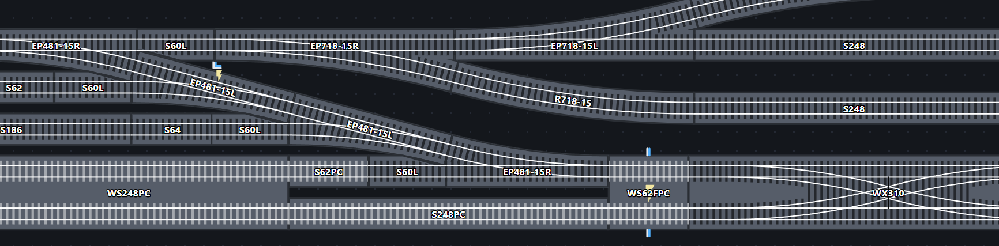

# Unitrack (N-scale) Floor Layout Planner

A free planner for N-scale Unitrack layouts, aimed at the temporary floor
layouts that are set up and taken down in a day (Japan's "tatami layouts").
Every piece is its real size, and track joins only where the real pieces would.

It is one HTML file: open `index.html` in a modern browser. Nothing is
installed and nothing is sent anywhere; layouts are saved to your computer.

Try it here now: https://pipanic.github.io/unitrack-floor-layout-planner/

## What it does

- Real KATO Unitrack geometry for straights, curves, turnouts, crossings,
  double track, viaducts, bridges, buffers, platforms and more.
- Snapping that follows how the real parts fit, with ground and 50 mm
  elevation, gradients, and a warning where track crosses too low.
- Power View (joints from the nearest feeder), UniJoiners, and a Fill Gap
  tool that finds the pieces to join two open ends.
- A parts list, with the fewest KATO packs that cover it, and an Inventory
  + Limited Mode that limits you to the track you own.
- Tabletop outlines, text labels, undo, PNG export, and save and load.

Press the red **?** in the header for the full guide.

## Not affiliated with KATO

This is an independent, unofficial project. It is not made by, affiliated with
or endorsed by KATO. KATO and Unitrack are trademarks of their owners and are
used only to say which track system the planner is for. Part numbers and dimensions
are published facts, and no KATO artwork or documents are included. Check them
against KATO's own catalogue before you buy.

## About this repository

This repository holds the released build: `index.html` is the whole planner,
in one file.

Most code was vibe-coded with Claude Sonnet, with Claude Opus conducting multiple
code reviews when appropriate, to tidy, find efficiencies, and make more elegant
the code.

## Licence

Free to use and share for non-commercial purposes under the
[PolyForm Noncommercial License 1.0.0](https://polyformproject.org/licenses/noncommercial/1.0.0)
(see `LICENSE`). You may not sell it or use it commercially. This is not an
open-source licence in the strict sense.

Commercial use, including by companies and retailers, needs the author's
written permission.

The planner is provided as it is, with no warranty and no promise of support.
